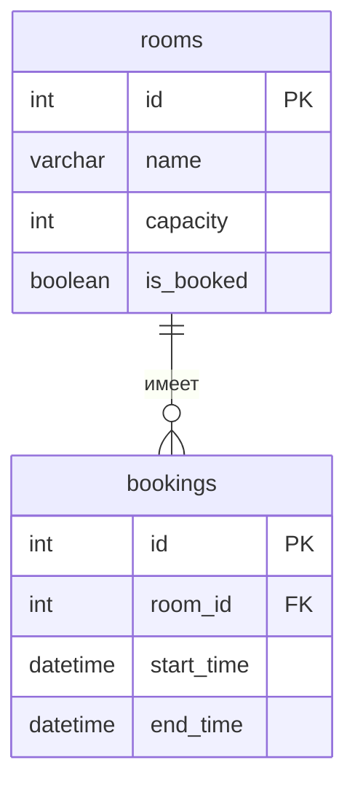

# Cumpus Booking

Тема №9: Переговорные комнаты в офисе и их бронирование. Приложение для онлайн бронирования аудиторий


| Главная сущность | Комната |
| Связанная сущность (1:N) | Бронь |
| Фишка | загрузка комнат в часах |
| Стек | python, django, PostgreSQL |

## Как запустить


```bash
# 1. Клонировать репозиторий
git clone https://github.com/Garpalica/Backend-2026.git
cd Backend-kurbatov-booking

# 2. Создать и активировать виртуальное окружение
python -m venv .venv
.venv\Scripts\activate

# 3. Установить зависимости
pip install -r requirements.txt

# 4. Применить миграции базы данных
python manage.py migrate

# 5. Запустить сервер
python manage.py runserver
```


Сервис работает на `http://localhost:8000`. Запросы для демонстрации лежат в `git_info_about_labs`.

## Эндпоинты

| Метод | URL | Описание |
|-------|-----|----------|
| GET | /health | сервер жив |
| GET | /api/rooms?limit=&offset=&name=&capacity=&is_booked= | список с пагинацией/фильтром |
| GET | /api/rooms/{id} | одна комната |
| POST | /api/rooms | создать (201) |
| PATCH | /api/rooms/{id} | обновить |
| DELETE | /api/rooms/{id} | удалить (204) |

## ER-диаграмма

<!-- С лабы 2. Блок mermaid GitHub рисует сам. -->



## Интерфейс

<!-- С лабы 4: скриншот, например  -->
